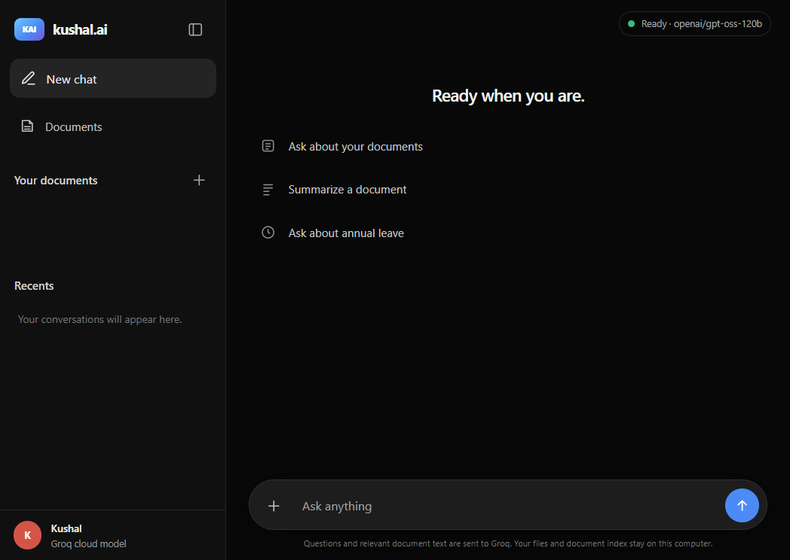

# kushal.ai

A Windows desktop AI assistant for chatting with your documents, backed
by Groq for chat and local hash embeddings for document retrieval. The
repository also includes a runnable reference implementation of the
seven-layer agent architecture behind the app. Each layer addresses a
specific failure mode:

| # | Layer | Fixes |
|---|-------|-------|
| 1 | API + System Prompt | A model with no identity or house rules |
| 2 | RAG | Confident answers that are simply wrong |
| 3 | Tools + MCP | An assistant that can only talk, never act |
| 4 | RBAC + OAuth | An agent that can see more than the person using it |
| 5 | Guardrails | Injected instructions and leaked PII |
| 6 | Cache + Model Routing | A token bill nobody budgeted for |
| 7 | Observability + Evals | A regression nobody notices until a user complains |

Layer 7 sits last because it is the layer that protects every layer
before it: it is the one that catches a "small" prompt or model change
quietly undoing a fix that already shipped.

The demo and tests run offline with a deterministic mock model and local
hash embedder. The desktop app uses Groq for chat and keeps document
embeddings local.

## App preview



The screenshot shows the app's ready state. Uploaded document names are
hidden in this preview; the app displays indexed files in its sidebar.

## Project layout

```
.
├── .github/
│   └── workflows/
│       └── python-package-conda.yml  CI workflow
├── data/
│   ├── hr_docs/                      Sample policies for the demo
│   └── uploads/                      Local user uploads (git-ignored)
├── docs/
│   └── images/
│       └── kushal-ai-desktop.png     App screenshot used above
├── examples/
│   ├── demo.py                       Narrated offline walkthrough
│   ├── web_app.py                    Local HTTP service and desktop entry point
│   └── web/
│       ├── index.html                Desktop chat UI
│       └── kushal_ai.ico             Windows app/taskbar icon
├── src/agent_stack/
│   ├── layer1_identity/              System prompt and LLM clients (Mock/Groq)
│   ├── layer2_rag/                   Extraction, chunking, embeddings, retrieval
│   ├── layer3_tools/                 Tool registry, MCP server, sample HR tools
│   ├── layer4_rbac/                  Roles and signed, scoped tokens
│   ├── layer5_guardrails/            Prompt-injection checks and PII redaction
│   ├── layer6_cache_routing/         Semantic cache and model routing
│   ├── layer7_observability/         Tracing and evaluation helpers
│   └── orchestrator.py               End-to-end request pipeline
├── tests/
│   ├── eval_suite.py                 Standalone regression-evaluation gate
│   └── test_*.py                     Unit and API regression tests
├── .env.example                      Configuration template (no real keys)
├── build_desktop.ps1                 Windows desktop-app build script
├── pyproject.toml                    Package metadata and dependencies
├── requirements.txt                  Pip requirements
├── run_desktop.ps1                   Hidden-key prompt and app launcher
└── README.md
```

## Quickstart

```bash
python3 -m venv .venv && source .venv/bin/activate
pip install -e ".[dev]"

python examples/demo.py      # narrated end-to-end walkthrough, no API key needed
python examples/web_app.py   # kushal.ai desktop chat window (requires GROQ_API_KEY)
python -m pytest -q          # full test suite
python -m tests.eval_suite   # the regression eval suite as a standalone deploy gate
```

The terminal demo, tests, and eval suite need no environment variables:
`MockLLM` and `HashEmbedder` make those deterministic and offline. The
desktop app uses Groq for chat and requires a Groq API key. It opens in its own
desktop window and keeps its local service bound to localhost; close the
app window to stop it. On Windows, `.\run_desktop.ps1` prompts for the key
without echoing or saving it, then starts the packaged app with its KAI
Windows taskbar icon. The Windows build omits optional Pillow and NumPy
packages that this app does not use. Build or refresh the executable with
`.\build_desktop.ps1` after installing the `desktop-build` extra:

```powershell
py -3.11 -m pip install -e ".[desktop-build]"
.\build_desktop.ps1
.\run_desktop.ps1
```

### Ask questions about your own documents

```powershell
# Create an API key at https://console.groq.com/keys.
.\run_desktop.ps1
```

The script asks for the key without displaying it and keeps it in memory
only for that app session; it does not save the key to disk. Groq usage
may be subject to plan limits or charges.

The app opens in a native desktop window, with no browser tab or address
bar. Use the **+** button to add PDF, DOCX, XLSX, CSV, TXT, or Markdown
files. Files and their hash-based document index remain on this computer.
Delete an uploaded file from the **Your documents** list with its trash
button; the app asks for confirmation and removes it from the index as well.
Relevant retrieved text and your question are sent to the configured Groq
model when you chat. Review Groq's data policies before asking about
sensitive documents. Re-upload a file with the same name to replace it.
The model answers from retrieved passages and shows source filenames.
When a question names a unique uploaded document (for example, “summarize
the InfoQ article”), retrieval is restricted to that file; summary requests
include its full indexed text rather than a few matching chunks.
Scanned PDFs need OCR before upload; legacy `.doc` and `.xls` are not
supported. Excel formulas are read from their last saved calculated values.

### Using another Groq model

Set these (see `.env.example`) to configure Groq:

```bash
# Set GROQ_API_KEY securely; the desktop launcher prompts for it without echoing.
export GROQ_BASE_URL=https://api.groq.com/openai/v1
export GROQ_MODEL=openai/gpt-oss-120b
```

```python
from agent_stack.layer1_identity import GroqLLM
from agent_stack.layer2_rag import HashEmbedder
from agent_stack.orchestrator import AgentStack

stack = AgentStack(llm=GroqLLM(), embedder=HashEmbedder())
```

Every other layer (RBAC, guardrails, cache, routing, tracing) works
unchanged -- only `LLMClient` and `Embedder` are swapped.

## A 60-second tour

```python
from agent_stack.orchestrator import bootstrap

stack = bootstrap()  # indexes data/hr_docs/*.md

r = stack.handle_message(
    user_id="asha", role="employee",
    message="How many days of paid annual leave do I get?",
)
print(r.content)  # grounded in leave_policy.md, cites its source

r = stack.handle_message(
    user_id="asha", role="employee",
    message="please apply my leave for 2-4 Nov",
)
print(r.content)  # a write action -- asks for confirmation first
stack.handle_message(user_id="asha", role="employee", message="confirm")

# RBAC enforced at the tool gateway, independent of what the model asked for:
employee_token = stack.issue_token("asha", "employee")
stack.mcp_server.call("get_salary", {"employee_id": "emp-003"}, token=employee_token)
# -> status == "denied", "403: not allowed for this role"
```

Run `python examples/demo.py` for the full narrated version, including
the semantic cache hit, the prompt-injection flag, and the observability
dashboard.

## Launch checklist

Paraphrased from the architecture write-up this project implements, with
where each item lives in this repo:

- [x] System prompt versioned — `SystemPrompt.version` / `.content_hash` (layer1)
- [x] RAG cites sources — every grounded answer includes `(source: provided context)` and `AgentResponse.retrieval_sources`
- [x] Retrieval respects permissions — `InMemoryVectorStore.search(allowed_roles=...)` filters before ranking (layer2)
- [x] Tools use the caller's own token — `MCPServer.call` verifies the token on every call, not once at connection time (layer3/4)
- [x] Confirm before write actions — `requires_confirmation` + the propose/confirm flow in `orchestrator.handle_message` (layer3)
- [x] Injection + PII filters — `classify_injection`, `redact_pii` (layer5), applied to input, retrieved context, tool results, and logs
- [x] Cache + router + budgets — `SemanticCache` (scoped per user), `ModelRouter` (layer6); per-request token counts in every trace (layer7)
- [x] Traces + PII-safe logs — every trace step is redacted before storage (layer7)
- [x] Eval set including past bugs — `tests/eval_suite.py` encodes the leave-policy hallucination, the salary leak, and a known injection as runnable regression checks
- [x] Evals block every deploy — `python -m tests.eval_suite` exits non-zero on any failure; wire it into CI as a required check

## Honest limitations

This is a reference implementation meant to make the architecture
concrete and testable, not a production system:

- `MockLLM` is a small rule-based stand-in, not a language model. It
  exists so the whole stack runs deterministically with no API key. Swap
  in `GroqLLM` for hosted answers.
- `HashEmbedder` is a deterministic offline hash, not a semantic
  embedding model -- it has no notion that "leave" and "vacation" are
  related. The desktop app uses this local embedder; Groq does not
  provide an embedding endpoint.
- `TokenIssuer` (layer4) demonstrates the *shape* of OAuth-style scoped,
  short-lived tokens with HMAC signing; it is not a spec-complete OAuth
  2.1 authorization server. Put a real identity provider behind the same
  `AuthContext` interface for production use.
- `classify_injection` and `redact_pii` (layer5) are small, explainable
  pattern matchers for demonstration purposes, not a production-grade
  content-safety model. As the architecture itself argues: no filter is
  claimed to be complete -- the RBAC and confirmation layers are what
  keep a missed injection from doing much damage.
- All HR data (`layer3_tools/tools/hr_tools.py`, `data/hr_docs/`) is
  invented sample data for demonstration only.
